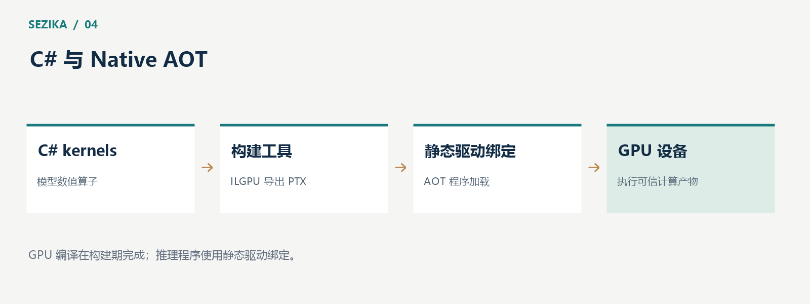

# Sezika 的 C# 与 Native AOT 路线：让本地推理可部署

Sezika 选择 C# 实现模型、数值算子与调度，并把 Native AOT 作为推理部署目标。这条路线不仅关系到语言选择，也关系到模型资产管理、GPU 编译边界和最终程序的依赖结构。

## 纯 C# 的边界在哪里

Sezika 所说的纯 C#，指项目的模型计算、CPU/GPU 算子和调度源代码使用 C#。运行时允许调用操作系统与显卡驱动 API，包括 CUDA Driver。

显卡驱动负责设备和 GPU 程序执行；数值计算库负责提供现成的计算实现。Sezika 的核心推理路线没有把模型计算交给 ONNX Runtime、LibTorch、cuBLAS 或 cuDNN，也没有通过 C++ 桥接层隐藏另一套模型实现。

这使关键计算路径可以在同一语言体系中阅读和维护。相应的代价是，项目需要自己验证矩阵运算、注意力、归一化以及前后向计算的正确性与性能。

## AOT 约束影响的是运行方式

Native AOT 把托管程序提前编译为目标平台的原生程序。它要求开发者认真处理动态代码、反射和裁剪相关问题。

在 Sezika 中，公共请求与结果采用静态类型，JSON 使用源生成方式，问题类型具有显式判别。这样的设计让接口更容易检查，也减少了运行时临时发现类型的需求。

模型权重仍然以外部资产加载。提前编译程序不意味着把权重嵌入可执行文件，更不意味着模型质量被编译器验证了。程序、权重、tokenizer 和校准文件各自有版本与许可，组合使用时需要核对兼容性。

## GPU 编译放在构建期

Sezika 使用 ILGPU 在构建阶段把 C# GPU kernels 导出为 PTX，并生成对应的调用描述与 ABI 信息。推理程序通过静态 C# CUDA Driver 绑定加载这些产物。

这一边界很关键：构建工具可以使用普通 .NET 的能力完成编译；最终 AOT 程序不依赖 ILGPU 的运行时动态编译与动态启动器。

PTX 还可能由驱动针对设备进行处理。这个过程属于 GPU 驱动执行路径，与 .NET 在运行时生成托管代码是不同层面的事情。因此，评估冷启动时需要把模型加载、GPU 模块加载和驱动处理分别考虑。

## 推理部署与训练工具分别设计

推理部署追求明确依赖与受控资源，因此保持 Native AOT 目标。训练、数据准备和构建工具可以使用 JIT 或自包含 .NET 10，便于执行离线工作。

把所有工具强行编译成 AOT，并不是推理可部署的必要条件。更有价值的工作，是明确最终程序到底依赖什么、如何读取模型、怎样分配资源，以及在失败和取消时能否正确释放资源。

项目的长期工具也正在向 C# 统一。这是一项持续的工程工作，不能把核心推理使用 C# 理解为所有历史辅助工具已经完成迁移。

## 验证一个部署产物需要回答哪些问题

一个可执行文件能够启动，只能说明入口可以运行。完整的推理验证还需要检查：真实模型是否正确加载，tokenizer 是否匹配，CPU 或 CUDA 路径是否实际执行，结果是否与参考范围一致，以及取消和释放是否正常。

Sezika 已有指定模型在 Windows 与 Linux WSL2 环境下的 Native AOT 验证。其结论属于当时的模型、程序和环境组合，不能自动覆盖新训练权重，也不能替代其他 Linux 部署环境的测试。

性能同样需要独立测量。AOT 是部署方式，不是固定的加速比例；程序启动、模型加载、首次推理与稳定运行的耗时也应分别记录。

## 这条路线适合什么样的系统

如果应用以 .NET 为主要技术栈，希望在本地管理模型和请求，并且重视可检查的计算路径，Sezika 的方向值得研究。模型与程序分开管理，也有利于在不重建应用的情况下更换经过验证的模型资产。

正式交付仍然需要同时满足语义质量、兼容性、部署正确性和资源预算。C# 与 Native AOT 提供工程基础，模型是否适合某个任务，则需要由该任务的真实评测回答。

实现路线见 [Sezika 项目文档](https://gitee.com/IoTSharp/Sezika)，Native AOT 的平台约束可参阅 [Microsoft 官方说明](https://learn.microsoft.com/en-us/dotnet/core/deploying/native-aot/)。
