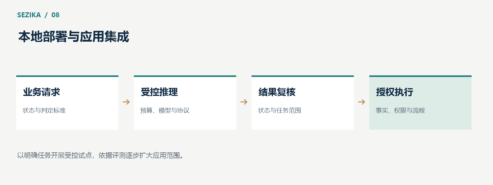

# Sezika 的应用集成：让语义判断进入现有业务系统

Sezika 面向本地、类型化的语义判断。把它接入业务系统时，首先需要定义判断目标、准备匹配的模型资产，再围绕请求预算、错误处理和人工复核安排完整流程。


## 从小而清楚的任务开始

一个适合试点的任务，通常具有有限输出、可获得的真实标签和可接受的复核成本。

客服分派可以从少数稳定类别开始，观察不同表达如何影响分类。告警摘要可以使用等级评分，为人工排序提供建议。材料检查可以判断文本是否明确包含指定信息，同时把事实核验交给业务系统。

这些场景都是集成设计示例，并不是项目已经完成的生产部署案例。每一个场景都需要自己的数据与评测。

## 把模型资产视为完整组合

应用需要核对编码器、决策头、tokenizer 与输入协议之间的匹配关系。校准文件若存在，也必须与对应模型和任务范围匹配。

Sezika 将这些资产与应用程序分开管理。更换权重后，需要重新检查加载、语义质量与性能；旧模型通过的验证，不能自然覆盖新模型。

这也有利于许可管理。项目代码、预训练模型、数据与 tokenizer 各自有来源和使用条件，部署时要检查所采用的完整组合。

## 明确选择输入协议

独立 `decision-v1` 请求具有显式 schema、模型标识、状态和问题数组。Choice、Score 与 Boolean 分别使用与其语义对应的字段。

下面只展示一个 Choice 请求的结构，不包含模型输出，也不是已经验证的业务判断：

```json
{
  "schema_version": 1,
  "model_id": "your-verified-model-id",
  "state": { "message": "账单似乎重复扣款，请协助核对。" },
  "questions": [
    {
      "id": "intent",
      "type": "choice",
      "instruction": "按消息表达的请求类别进行分派。",
      "candidates": [
        { "id": "billing", "text": "账单、支付或退款问题" },
        { "id": "technical", "text": "软件功能或访问故障" },
        { "id": "other", "text": "以上类别以外的请求" }
      ]
    }
  ]
}
```

其中模型标识需要替换为实际核验的资产身份。候选定义也需要按照应用自己的分类规则调整，随后用真实消息评测。



## 给请求设置资源边界

应用应限制输入字节、token、候选数量、问题数量、排队长度和执行时间。模型调用进入有界队列，避免流量增长时把内存或显存耗尽。

Sezika 的独立 CLI 提供显式模型格式与执行预算。不同入口的默认模型格式和长度范围存在区别，集成时应依据当前文档明确选择，避免依赖隐含默认值。

核心 CPU/CUDA 实现与某个具体 facade 或 CLI 的后端选择，也需要分别核对。不能因为仓库存在 CUDA backend，就假设每个入口都已经自动使用 GPU。

## 接纳结果之前检查三件事

第一，推理是否成功完成。输入错误、取消和设备故障都应走错误路径。

第二，结果是否属于模型已评测的任务范围。新语言、新领域或新的候选定义，可能改变表现。

第三，业务是否允许后续动作。模型提供意图或等级，实际操作仍需身份、权限与事实检查。资金、设备和用户权益相关动作尤其需要明确的审批或复核机制。

## 本地运行仍需要保护数据

业务文本不发送到远程模型服务，是本地推理的重要特征；它并不自动完成隐私保护。日志可能保留敏感输入，模型目录需要控制权限，错误报告也应避免泄露业务内容。

应用可以记录模型版本、耗时、错误类型、类别分布和人工复核结果，在满足权限与保留策略的前提下建立可观察性。是否保存原始文本，应由具体业务与数据政策决定。

## 从试点评测走向正式使用

先使用真实、隔离的样本评估正确率、拒答与误判类型，再测量目标设备上的加载时间、稳定延迟、吞吐和资源峰值。上线后的数据分布变化也需要持续观察。

截至 2026 年 10 月 13 日，Sezika 的完整训练、正式多语言质量与概率校准仍待完成。当前可以开展研究和受控试点；正式使用需要对具体模型、业务与部署环境取得独立证据。

项目欢迎参与 C# / CUDA 实现、数据评测与算力支持。使用说明与当前计划可在 [Sezika 项目主页](https://gitee.com/IoTSharp/Sezika)查看。
